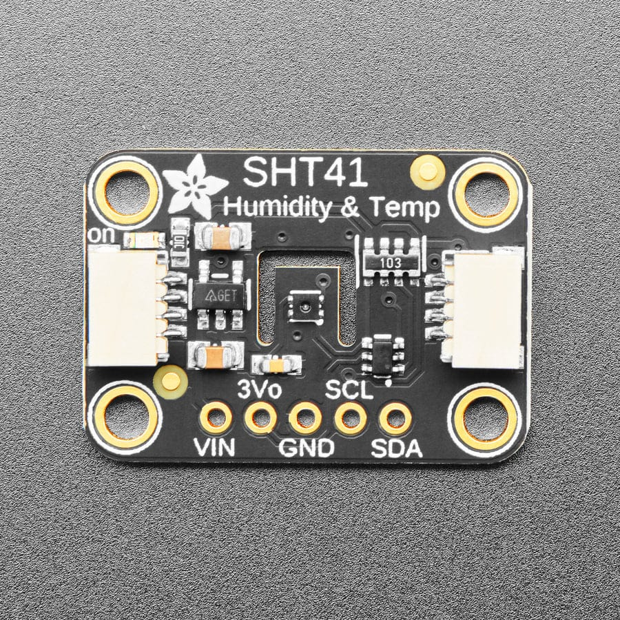

# Wiring

Wiring for the Seeed Studio XIAO nRF52840, an Adafruit SHT41 (STEMMA QT) breakout and 2 × AA lithium cells.

> **Note:** the firmware moves I2C off the XIAO's default pins. Seeed's pinout shows I2C on D4/D5, but this project uses **D10 (SDA)** and **D9 (SCL)** so the sensor wires sit next to GND and 3V3. D4/D5 are used as buttons instead. See `boards/xiao_ble_nrf52840.overlay`.

## Diagram

XIAO shown from the top, USB-C connector at the top.

```
                              ┌────────┤USB-C├────────┐
                        D0 ───┤ ●                   ● ├─ 5V   (leave unconnected)
                        D1 ───┤ ●                   ● ├─ GND  ─────────●───────────────┐
                        D2 ───┤ ●                   ● ├─ 3V3  ───────●─┼─────────────┐ │
       GND ──[btn0]──── D3 ───┤ ●                   ● ├─ D10  ─────┐ │ │             │ │
       GND ──[btn1]──── D4 ───┤ ●                   ● ├─ D9   ───┐ │ │ │             │ │
       GND ──[btn2]──── D5 ───┤ ●                   ● ├─ D8      │ │ │ │             │ │
       GND ──[btn3]──── D6 ───┤ ●                   ● ├─ D7      │ │ │ │             │ │
                              └───────────────────────┘          │ │ │ │             │ │
                                                                 │ │ │ │             │ │
                                   Adafruit SHT41 (STEMMA QT)    │ │ │ │             │ │
                                   ┌──────────────┐              │ │ │ │             │ │
                                   │ SCL  yellow  │◄─────────────┘ │ │ │             │ │
                                   │ SDA  blue    │◄───────────────┘ │ │             │ │
                                   │ VIN  red     │◄─────────────────┘ │             │ │
                                   │ GND  black   │◄───────────────────┘             │ │
                                   └──────────────┘                                  │ │
                                                                                     │ │
                                   2 × AA lithium (Li-FeS2), in series               │ │
                                   ┌────────────────────────────┐                    │ │
                                   │  +[ AA ]−──+[ AA ]−        │                    │ │
                                   │  BAT+  3.0–3.6 V           │────[ on/off ]──────┘ │
                                   │  BAT−                      │──────────────────────┘
                                   └────────────────────────────┘
```

## Connections


| From | To |
|-|-|
| Battery + (through the holder's on/off switch) | XIAO **3V3** |
| Battery − | XIAO **GND** |
| SHT41 VIN (red) | XIAO **3V3** |
| SHT41 GND (black) | XIAO **GND** |
| SHT41 SDA (blue) | XIAO **D10** (P1.15) |
| SHT41 SCL (yellow) | XIAO **D9** (P1.14) |
| Button 0 (recommended) | D3 to GND |
| Buttons 1–3 (optional) | D4, D5 and D6, each to GND |
| XIAO 5V/VBUS, and the BAT+/BAT− pads on the back | Leave unconnected |

All buttons are momentary push buttons to GND. The overlay enables the internal pull-ups, so no resistors are needed.

## Buttons

- **Button 0 (D3)** is the Matter function button:
  - **Short press:** starts Bluetooth advertising for commissioning, if the device isn't commissioned yet.
  - **Hold for about 6 s:** factory reset. After 3 s all three LEDs start blinking. Keep holding for 3 more seconds to reset. Releasing it while they blink cancels the reset. The reset erases the pairing and Thread network settings, then reboots and starts advertising. The firmware is kept.
- **Buttons 1–3 (D4–D6)** are defined in the overlay, but the firmware doesn't use them. They can be left unconnected.

Without button 0, the device can only be reset by removing it in the controller app while it is online (it then erases its pairing and reboots), or by erasing its flash with a debugger. Reflashing the UF2 file keeps the stored pairing.

## Power

### Why the battery goes to the 3V3 pin

- Two lithium AAs give about 3.6 V when fresh, around 3.0–3.3 V for most of their life, and 1.8–2.0 V when flat.
- The nRF52840 runs directly on 1.7–3.6 V, and the SHT41 sensor chip runs down to 1.08 V. So the cells can feed the 3.3 V rail directly. This skips the XIAO's regulator, which would waste voltage and a large part of the battery capacity.
- **Don't use the BAT+/BAT− pads** on the back. They connect to the XIAO's LiPo charger. With USB plugged in, the charger would try to charge the AAs, and lithium primary cells must never be charged.
- **Don't use the 5V pin.** 3.6 V is too low for that input.

### ⚠️ Never plug in USB while the batteries are connected

With USB connected, the XIAO's regulator drives 3.3 V onto the same rail as the batteries. That pushes current back into the cells, which is unsafe for non-rechargeable lithium. **Switch the battery holder off, or take the cells out, before flashing or plugging in USB.**

To protect against this, add a Schottky diode (for example a BAT54 or 1N5817) in the battery + line, with the stripe (cathode) towards 3V3. The trade-off is a drop of roughly 0.2–0.3 V, which costs some usable capacity at the end of battery life.

## Other notes

- **Polarity:** the 3V3 pin has no reverse-polarity protection. Check + and − before inserting the cells.
- **SHT41 power LED:** the Adafruit breakout's power LED is always on and draws around 1 mA. That's more than the rest of the circuit uses when idle, and on its own it would drain the batteries in months. The firmware can't switch it off, because it's wired straight to the power rail, and this board (Adafruit 5776) has no LED jumper. To disable it, remove either the LED (top left of the front, next to the `on` label) or the small resistor right beside it, using a soldering iron or by carefully flicking it off with a craft knife. Removing the resistor is easier. Neither part is needed for the sensor to work.

  
- **SHT41 breakout below 3.3 V:** the breakout's own regulator passes through a slightly lower voltage. The sensor tolerates this, so it keeps working as the batteries drain.
- **Battery level:** no fuel gauge is needed. The firmware measures the battery voltage with the nRF52840's internal ADC, see [BATTERY.md](BATTERY.md).
- **Missing sensor:** if the SHT41 isn't wired correctly, the firmware stops at boot. Matter doesn't start and the device can't be commissioned. Check the SDA/SCL wiring first.
